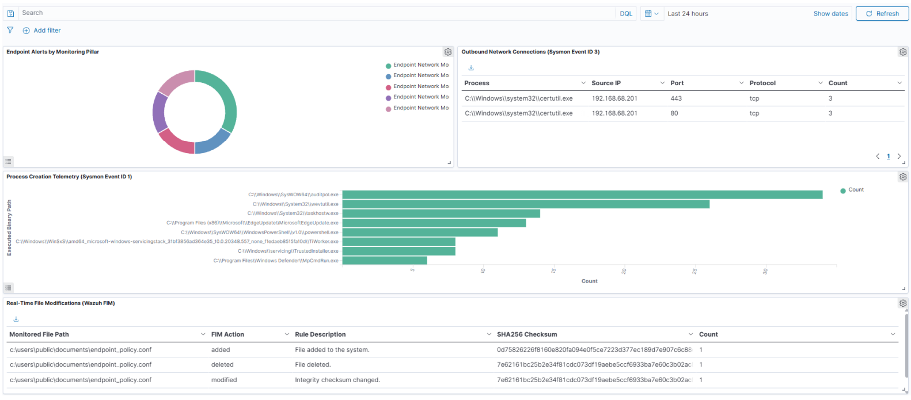
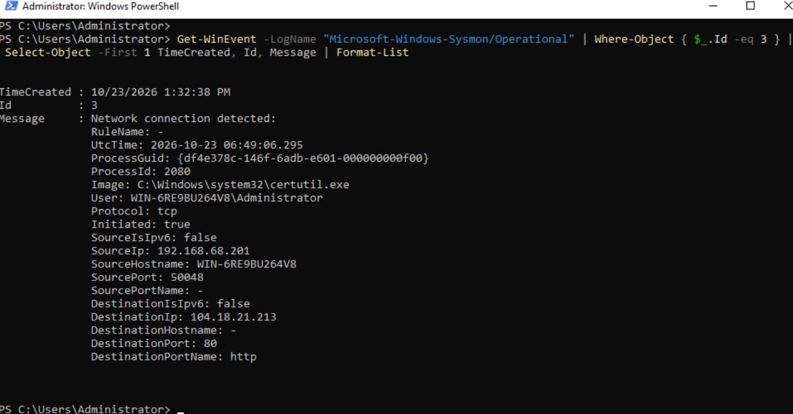
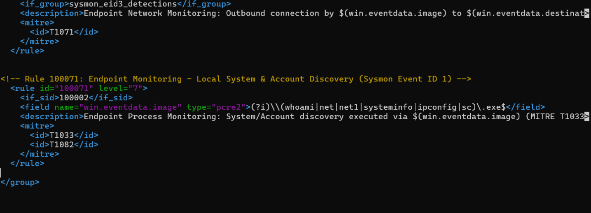
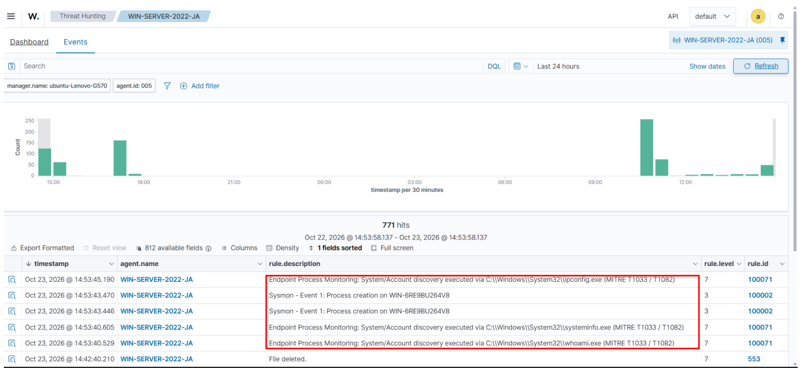
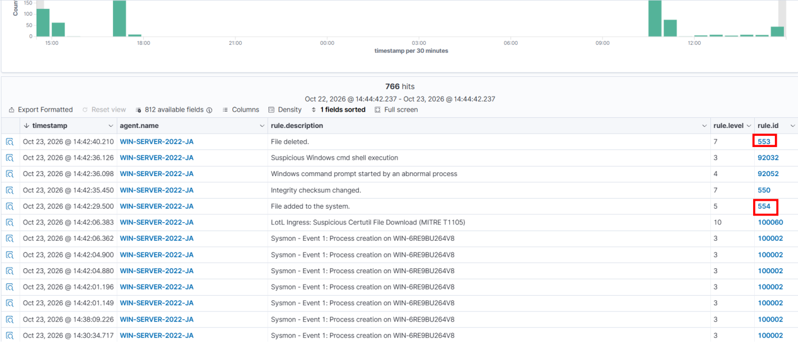

# Windows Endpoint Security Monitoring with Sysmon and Wazuh


## 1. Executive Summary
Standard Windows Event Logs often lack the process, network, and file-level granularity required for real-time SOC triage and incident investigation. This project implements an end-to-end **Windows Endpoint Security Monitoring Pipeline** by integrating **Microsoft Sysinternals Sysmon** (`v15.22`) with **Wazuh SIEM** (`v4.14.8`).

The monitoring pipeline captures, normalizes, and alerts on endpoint telemetry across three operational visibility pillars:
1. **Process Creation & Discovery Auditing (`Sysmon Event ID 1`)**
2. **Outbound Network Connection Tracking (`Sysmon Event ID 3`)**
3. **Real-Time File Integrity Monitoring (`Wazuh Syscheck FIM` & `Sysmon Event ID 11`)**



---

## 2. Lab Architecture & Environment

| Component | Role | Specifications |
| :--- | :--- | :--- |
| **Wazuh Manager & Indexer** | SIEM Correlation Engine & OpenSearch Analytics | Ubuntu 24.04 LTS (`ubuntu-Lenovo-G570` / `192.168.68.157`) |
| **Monitored Windows Endpoint** | Target Server Host (`Agent ID: 005`) | Windows Server 2022 Standard (`WIN-SERVER-2022-JA` / `192.168.68.201`) |
| **Endpoint Telemetry Sensor** | Kernel-Level Process & Network Logging | Sysmon `v15.22` (SwiftOnSecurity Modular Schema) |
| **Log Transport** | Wazuh Agent (`v4.14.8`) | Encrypted EventChannel & Syscheck over TCP Port `1514` |

---

## 3. Phase 1: Multi-Pillar Telemetry Generation

To validate end-to-end visibility across the Windows Server 2022 host (`WIN-6RE9BU264V8`), controlled telemetry was generated in an elevated PowerShell session across all three monitoring pillars:

```powershell
# 1. Pillar 1: Process Creation & Local Enumeration (Sysmon Event ID 1)
whoami.exe /all | Out-Null
systeminfo.exe | Select-Object -First 5
ipconfig.exe /all | Out-Null

# 2. Pillar 2: Outbound Network Activity (Sysmon Event ID 3)
Invoke-WebRequest -Uri "[https://raw.githubusercontent.com/SigmaHQ/sigma/master/README.md](https://raw.githubusercontent.com/SigmaHQ/sigma/master/README.md)" -UseBasicParsing | Out-Null
certutil.exe -urlcache -split -f "[https://hackuptechnology.com](https://hackuptechnology.com)" "C:\Tools\net_test.txt"

# 3. Pillar 3: Real-Time File Modification in Monitored Directory (Wazuh FIM)
New-Item -Path "C:\Users\Public\Documents\endpoint_policy.conf" -ItemType File -Value "Port=443`nAllowRemote=False" -Force
Start-Sleep -Seconds 5
Set-Content -Path "C:\Users\Public\Documents\endpoint_policy.conf" -Value "Port=4444`nAllowRemote=True"
Start-Sleep -Seconds 5
Remove-Item -Path "C:\Users\Public\Documents\endpoint_policy.conf" -Force
```

### Local Windows Event Channel Verification (`Sysmon Event ID 3`)
Before forwarding to the SIEM, local capture of outbound TCP connections was verified in the `Microsoft-Windows-Sysmon/Operational` log:

```powershell
Get-WinEvent -LogName "Microsoft-Windows-Sysmon/Operational" | Where-Object { $_.Id -eq 3 } | Select-Object -First 1 TimeCreated, Id, Message | Format-List
```



---

## 4. Phase 2: Custom Detection Rule Engineering & Alert Tuning

By default, Wazuh suppresses routine Sysmon Event ID 3 network connections at Level 0 and logs standard Sysmon Event ID 1 process creations as generic informational events (`Rule 100002`, Level 3). Custom rules were engineered in `/var/ossec/etc/rules/local_rules.xml` to surface high-value operational and security telemetry.



---

### Pillar 1: Process Creation & Host Discovery (`Rule 100071`)
Chained onto base Sysmon Process Creation (`<if_sid>100002</if_sid>`), **Rule 100071** uses PCRE2 regular expressions to detect local system, account, and network discovery utilities (`whoami.exe`, `systeminfo.exe`, `ipconfig.exe`, `net.exe`, `sc.exe`), elevating them to a **Level 7** alert mapped to **MITRE ATT&CK T1033 & T1082**:

```xml
<!-- Rule 100071: Endpoint Monitoring - Local System & Account Discovery (Sysmon Event ID 1) -->
<rule id="100071" level="7">
  <if_sid>100002</if_sid>
  <field name="win.eventdata.image" type="pcre2">(?i)\\(whoami|net|net1|systeminfo|ipconfig|sc)\.exe$</field>
  <description>Endpoint Process Monitoring: System/Account discovery executed via $(win.eventdata.image) (MITRE T1033 / T1082)</description>
  <mitre>
    <id>T1033</id>
    <id>T1082</id>
  </mitre>
</rule>
```

**Verified Telemetry in `/var/ossec/logs/alerts/alerts.json`:**
```json
{
  "timestamp": "2026-10-23T14:53:45.190+0530",
  "rule": {
    "level": 7,
    "description": "Endpoint Process Monitoring: System/Account discovery executed via C:\\\\Windows\\\\System32\\\\ipconfig.exe (MITRE T1033 / T1082)",
    "id": "100071",
    "mitre": {
      "id": ["T1033", "T1082"],
      "tactic": ["Discovery"],
      "technique": ["System Owner/User Discovery", "System Information Discovery"]
    }
  },
  "agent": { "id": "005", "name": "WIN-SERVER-2022-JA", "ip": "192.168.68.201" },
  "data": {
    "win": {
      "system": { "eventID": "1", "channel": "Microsoft-Windows-Sysmon/Operational" },
      "eventdata": {
        "image": "C:\\\\Windows\\\\System32\\\\ipconfig.exe",
        "commandLine": "\\\"C:\\\\Windows\\\\system32\\\\ipconfig.exe\\\" /all",
        "parentImage": "C:\\\\Windows\\\\System32\\\\WindowsPowerShell\\\\v1.0\\\\powershell.exe",
        "user": "WIN-6RE9BU264V8\\\\Administrator",
        "hashes": "MD5=A8430B55CB14D122A66574AF34DA4E9C,SHA256=DE85261DAF12E338725994FF1D4F3399CB2BCABEF3960B55B842EA85FC318132"
      }
    }
  }
}
```



---

### Pillar 2: Outbound Network Connection Monitoring (`Rule 100070`)
Hooked into the `sysmon_eid3_detections` group, **Rule 100070** elevates monitored Sysmon Event ID 3 network connections to **Level 6** (`MITRE T1071`) and dynamically extracts the initiating binary path, destination IP address, and destination port into the alert description:

```xml
<!-- Rule 100070: Endpoint Monitoring - Outbound Network Connection (Sysmon Event ID 3) -->
<rule id="100070" level="6">
  <if_group>sysmon_eid3_detections</if_group>
  <description>Endpoint Network Monitoring: Outbound connection by $(win.eventdata.image) to $(win.eventdata.destinationIp):$(win.eventdata.destinationPort) (MITRE T1071)</description>
  <mitre>
    <id>T1071</id>
  </mitre>
</rule>
```

**Verified Telemetry in `/var/ossec/logs/alerts/alerts.json`:**
```json
{
  "timestamp": "2026-10-23T13:39:09.264+0530",
  "rule": {
    "level": 6,
    "description": "Endpoint Network Monitoring: Outbound connection by C:\\\\Windows\\\\system32\\\\certutil.exe to 104.18.21.213:80 (MITRE T1071)",
    "id": "100070",
    "mitre": {
      "id": ["T1071"],
      "tactic": ["Command and Control"],
      "technique": ["Application Layer Protocol"]
    }
  },
  "agent": { "id": "005", "name": "WIN-SERVER-2022-JA", "ip": "192.168.68.201" },
  "data": {
    "win": {
      "system": { "eventID": "3", "channel": "Microsoft-Windows-Sysmon/Operational" },
      "eventdata": {
        "image": "C:\\\\Windows\\\\system32\\\\certutil.exe",
        "protocol": "tcp",
        "sourceIp": "192.168.68.201",
        "sourcePort": "50048",
        "destinationIp": "104.18.21.213",
        "destinationPort": "80",
        "destinationPortName": "http"
      }
    }
  }
}
```

---

### Pillar 3: Real-Time File Integrity Monitoring (`Wazuh Syscheck FIM`)
Wazuh's real-time `syscheck` subsystem monitors `C:\Users\Public\Documents` for unauthorized file additions, modifications, and deletions, recording `MD5`, `SHA1`, and `SHA256` checksums alongside Windows DACL permissions:
* **Rule `554` (Level 5):** `File added to the system.` (`endpoint_policy.conf` created; initial SHA256: `0d75826226f8160e820fa094e0f5ce7223d377ec189d7e907c6c88d62908d595`)
* **Rule `550` (Level 7):** `Integrity checksum changed.` (`endpoint_policy.conf` modified; updated SHA256: `7e62161bc25b2e34f81cdc073df19aebe5ccf6933ba7e60c3b02ac...`)
* **Rule `553` (Level 7):** `File deleted.` (`MITRE T1070.004 / T1485`)



---

## 5. Phase 3: Custom Endpoint Security Dashboard
A dedicated four-panel OpenSearch Dashboard was built in Wazuh (`agent.id: "005"`) to correlate all three telemetry pillars on a single pane of glass:
1. **Endpoint Alerts by Monitoring Pillar (Donut Chart):** Segments alert volume across Process (`100071`), Network (`100070`), and FIM (`550`, `553`, `554`) rules.
2. **Outbound Network Connections (Sysmon Event ID 3 Data Table):** Tracks the initiating binary (`data.win.eventdata.image`), source IP (`192.168.68.201`), target port (`80` / `443`), and transport protocol (`tcp`).
3. **Process Creation Telemetry (Sysmon Event ID 1 Bar Chart):** Ranks the top executed binary paths (`data.win.eventdata.image`) across the Windows Server host.
4. **Real-Time File Modifications (Wazuh FIM Data Table):** Displays the monitored file path (`syscheck.path`), FIM action (`added`, `modified`, `deleted`), alert description, and post-change `SHA256` checksum (`syscheck.sha256_after`).

---

## 6. Repository Structure
```text
Windows-Endpoint-Security-Monitoring-Lab/
├── assets/
│   ├── endpoint-monitoring-dashboard.png
│   ├── process-discovery-alerts.png
│   ├── sysmon-network-event3.png
│   ├── fim-lifecycle-alerts.png
│   └── custom-rules-nano.png
├── configs/
│   └── ossec.conf
├── rules/
│   └── local_rules.xml
├── LICENSE
└── README.md
```
